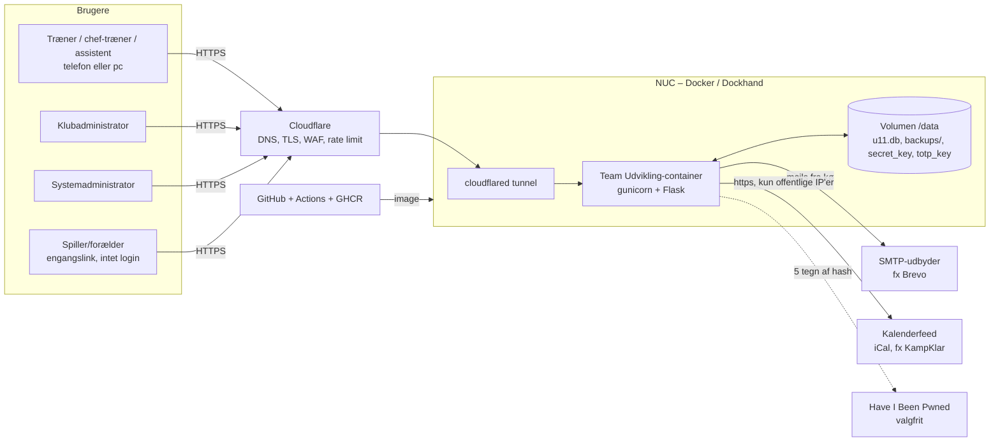
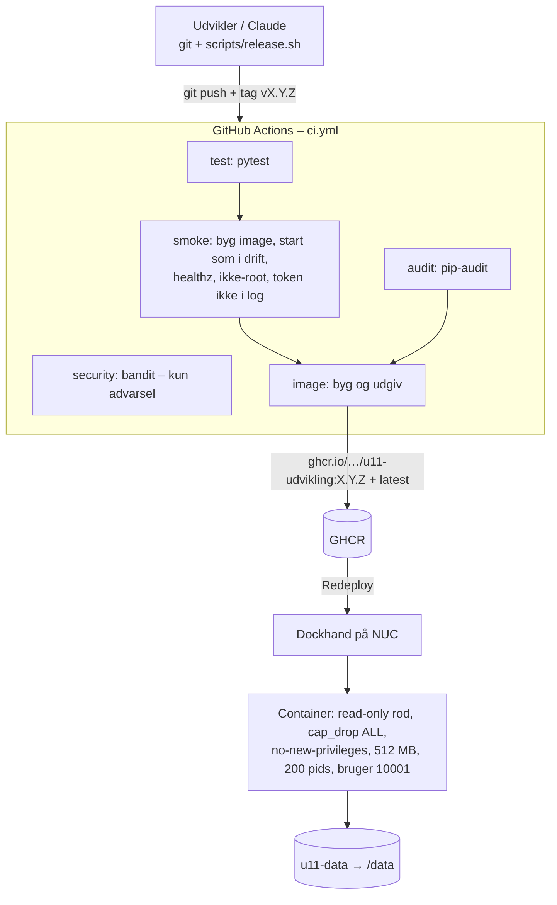
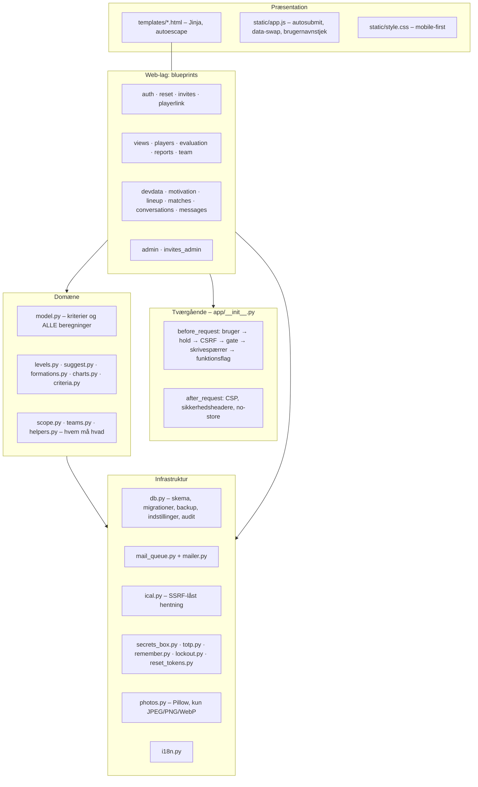
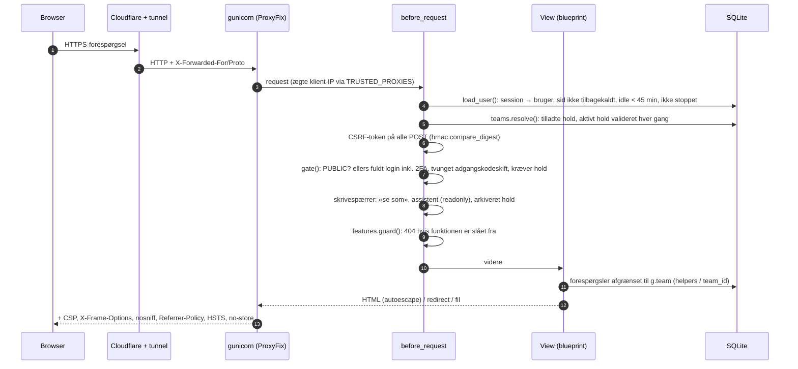
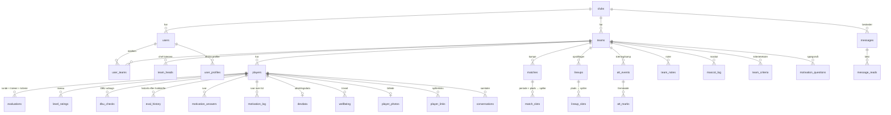

# Arkitektur – Team Udvikling

> Gælder fra v0.30.0. Relaterede dokumenter: [FUNKTIONER.md](FUNKTIONER.md) (hvad systemet gør), [SWIMLANES.md](SWIMLANES.md) (processer på tværs af roller),
> [ARKITEKTURGENNEMGANG.md](ARKITEKTURGENNEMGANG.md) (kritisk gennemgang og forslag), [SECURITY.md](SECURITY.md), [GDPR.md](GDPR.md),
> [MIGRATIONS.md](MIGRATIONS.md), [BACKUP.md](BACKUP.md), [DRIFT.md](DRIFT.md), [DECISIONS.md](DECISIONS.md).
> Diagrammerne er Mermaid og vises direkte på GitHub.

## 1. Overblik

Team Udvikling er en selvhostet webapp til trænere på børnehold. Den samler evaluering efter DBU's fire roller × seks nøglefærdigheder,
udviklingsdata, motivation, kampe/spilletid og kommunikation i én app med klub- og holdafgrænsning.

| Egenskab | Valg | Hvorfor |
|---|---|---|
| Sprog/ramme | Python 3.13, Flask 3.1, Jinja2 (server-renderet HTML) | Lille, gennemskuelig kodebase; ingen build-trin |
| Database | SQLite i WAL-tilstand, én fil i `/data` | Ingen databaseserver at drive; nok til få hundrede brugere |
| Webserver | gunicorn (2 workers × 2 tråde) i én container | Enkel drift på en hjemmeserver |
| Frontend | HTML + CSS + ét lille script (`static/app.js`), virker uden JS | Streng CSP, ingen tredjeparts-JS |
| Diagrammer | Server-genereret SVG (`charts.py`) | Ingen JS-biblioteker |
| Login | Adgangskode (scrypt) + obligatorisk TOTP-2FA | Børns persondata |
| Drift | Docker-image fra GHCR, deployes med Dockhand på NUC, eksponeret via Cloudflare Tunnel | Ingen åbne porte i routeren |
| Afhængigheder | Flask, Werkzeug, gunicorn, Pillow, openpyxl, qrcode, cryptography, defusedxml | Få og velkendte; `pip-audit` blokerer udgivelse |

## 2. Systemkontekst

Den eneste vej ind er HTTPS via Cloudflare → tunnel → container. Udgående trafik: SMTP, iCal-feed (SSRF-låst) og valgfrit HIBP.

## 3. Udrulning (deployment)

Containerindstillinger (`compose.yaml`): skrivebeskyttet rodfilsystem, `/tmp` som tmpfs, alle Linux-capabilities fjernet,
`no-new-privileges`, hukommelses- og procesgrænse, healthcheck på `/healthz`. Konfiguration sker kun via miljøvariabler
(se tabellen i afsnit 11).

## 4. Lagdeling og moduler

### Moduloversigt

| Modul | Ansvar | Vigtigste ruter |
|---|---|---|
| `__init__.py` | `create_app`, konfiguration, request-pipeline, sikkerhedsheadere, baggrundsjob, driftstjek ved start | `/healthz` |
| `auth.py` | Login, 2FA-opsætning/-bekræftelse, gendannelseskoder, konto, første opsætning, «se som», `gate()`, `PUBLIC` | `/login`, `/login/2fa`, `/setup`, `/account` |
| `lockout.py` · `remember.py` · `totp.py` · `secrets_box.py` | Kontolås uden lås-DoS, «husk enhed», TOTP (RFC 6238), Fernet-kryptering af TOTP-hemmeligheder | – |
| `reset.py` · `reset_tokens.py` | Admin-godkendt nulstilling af adgangskode/2FA via e-mail (1 time, engangs) | `/nulstil/<token>` |
| `invites.py` | Invitationer (7 dage, engangs) og oprettelse af bruger med 2FA | `/invitation/<token>`, `/admin/invitations/` |
| `scope.py` · `teams.py` · `profiles.py` | Roller, klub-/holdadgang, aktivt hold, flere profiler pr. bruger | `/switch-team`, `/switch-profile` |
| `helpers.py` | `team_id()`, `active_players()`, `get_player()` (404 på fremmed hold), runde-info | – |
| `views.py` | Forside, mobilforside, menu, kriterier, privatliv, logo, sprogvalg, aktivitet | `/`, `/m`, `/menu`, `/sprog` |
| `players.py` | Spillere, billeder, JSON-eksport (indsigt), flytning | `/players/…` |
| `evaluation.py` | Evalueringsrunder, skema, teamoversigt, udvikling, position/bane, områder, spillerprofil | `/eval…`, `/overview`, `/profile/<pid>` |
| `model.py` · `criteria.py` · `levels.py` | Kriterier, beregninger (samlet, enighed, relativ alder), holdets kriterietekster, niveau (A+…D) | – |
| `reports.py` | Spillerrapport (A4) og forældrerapport | `/report/<pid>`, `/reports…` |
| `team.py` | Holdside, indstillinger, funktionsflag, kriterietekster, niveauer, fokus, noter, maskot, kalender, sæsonskifte | `/team/…` |
| `devdata.py` | Fremmøde, kampdeltagelse, trivsel, motorik, handleplan | `/devdata/…` |
| `motivation.py` | Motivationsskema (22 spørgsmål, 3 kategorier), tablet-visning, spillerlinks | `/motivation/…`, `/svar/<token>` |
| `lineup.py` · `formations.py` · `split.py` | Opstillinger, idealopstilling, positionsmatch, deling af truppen i A/B/C-hold (rene funktioner i `split.py`) | `/lineup/…` |
| `matches.py` · `suggest.py` · `ical.py` | Kampe, spilletid pr. position, hvide pletter, opstillingsforslag, kampforslag fra kalender | `/kampe/…` |
| `conversations.py` | Forældre-/spillersamtaler pr. spiller | `/samtaler/<pid>` |
| `messages.py` · `mail_queue.py` · `mailer.py` | Indbakke (klub/hold/alle/svar), e-mail-kø med genforsøg, SMTP | `/inbox/…`, `/admin/mail` |
| `admin.py` + `admin_more.py` | Brugere, hold, klubber, driftsindstillinger, backup, eksport, brug, revisionslog, e-mail-kø, driftstjek (admin.py); klubprofil, sikkerhedslog, opbevaringsfrist, import, evalueringsrunder, backlog (admin_more.py) – samme blueprint `admin` | `/admin/…` |
| `importer.py` | Import fra Excel/CSV (to trin: forhåndsvisning → bekræft) | `/admin/import` |
| `photos.py` | Validering, EXIF-fjernelse, beskæring, miniaturer | – |
| `activity.py` | «Aktive nu» og brugsstatistik pr. kvarter (uden indhold) | `/aktivitet`, `/admin/usage` |
| `heatcfg.py` | Holdets farver og forklaringer for score 1–5 (`heat`/`heat_fg`, forklaring i `_heat_legend.html`) | `/team/farver` |
| `charts.py` · `filters.py` | Radar, linje, søjler, bane, varmekort som SVG; Jinja-filtre (dato, farver) | – |
| `club.py` · `backlog_seed.py` | Klubprofil, logo, farver, motto; startindhold til appens interne backlog | `/branding/logo/<id>`, `/admin/club` |
| `i18n.py` | Sprog (da/en/de/sv/no), `_()` i skabeloner | – |
| `selfcheck.py` · `logredact.py` | Driftstjek af farlige indstillinger; tokens fjernes fra adgangsloggen | – |
| `features.py` | Funktioner der kan slås til/fra pr. hold (404 når slået fra) | – |
| `transfer.py` | Holdskifte (evalueringer følger spilleren som historik), stop af træner | – |

## 5. Request-pipeline

## 6. Roller og adgang

| Handling | Assistent | Træner | Chef-træner (eget hold) | Klubadministrator (egen klub) | Systemadministrator |
|---|---|---|---|---|---|
| Se holdets spillere, oversigter, rapporter | ✓ | ✓ | ✓ | ✓ | ✓ |
| Evaluere spillere | ✓ (tæller kun med, hvis chef-træneren vælger det) | ✓ | ✓ | ✓ | ✓ |
| Oprette/rette spillere, fremmøde, kampe, noter m.m. | – | ✓ | ✓ | ✓ | ✓ |
| Holdindstillinger, runder, funktionsflag, kalenderlink, besked til holdet | – | – | ✓ | ✓ | ✓ |
| Invitere trænere/assistenter | – | – | ✓ (eget hold) | ✓ | ✓ |
| Klubprofil, klubbesked, brugere i klubben, opbevaringsfrist | – | – | – | ✓ | ✓ |
| Slette spillere, eksport, import, backup, sikkerhedslog, e-mail-kø, alle klubber | – | – | – | – | ✓ |

Teknisk: rolle i `users.role` (`trainer`/`clubadmin`/`admin`), assistent = `users.readonly=1`, chef-træner = række i `team_heads`,
holdmedlemskab i `user_teams`. Afgøres i `scope.py`, `team.can_configure()` og `admin_required`/`manager_required`.

## 7. Datamodel

Øvrige tabeller: sikkerhed (`recovery_codes`, `remember_tokens`, `reset_tokens`, `invitations`, `login_fails`, `login_attempts`,
`revoked_sessions`, `security_events`), drift (`settings` med nøgler `t<hold-id>:<navn>`, `audit_log`, `activity`, `presence`,
`mail_queue`, `schema_migrations`, `backlog_items`), `team_mascot_img`, `motivation_categories`.

Fremmednøgler er `ON DELETE CASCADE`: sletning af et hold eller en spiller sletter alle tilhørende data (GDPR).
`evaluations.crit` = `rolle × 6 + færdighed` (0–23).

## 8. Beregninger (`model.py`, `levels.py`, `suggest.py`)

- **Rolle-gennemsnit** pr. træner = gennemsnit af trænerens scores i rollen; holdets værdi = gennemsnit over trænerne.
- **Samlet** = gennemsnit af de fire rolle-gennemsnit. Skala: 3 ≈ årgangsniveau (B), 4 ≈ A, 5 ≈ A+.
- **Enighed** = største minus mindste samlede score mellem trænere (≥ 2 trænere).
- **Assistenter** tæller kun med i en runde, hvis chef-træneren har valgt det (`assist_ok_<runde>`).
- **Viste runder**: kun runder, hvor alle aktive spillere er evalueret; profilen viser de to seneste.
- **Relativ alder**: fødselskvartal; overvægt ved ≥ 65 % født i 1. halvår.
- **Niveau**: trænerens DBU-afkrydsning (flest af A/B/C/D) eller samlet vurdering; ellers afledt af samlet score.
- **Opstillingsforslag**: pr. periode vælges spillerne med mindst spilletid; de fordeles på pladserne med ungarsk metode, hvor en
  position spilleren aldrig har spillet (hvid plet) er billigst.

## 9. Baggrundsjob

Én daemon-tråd pr. gunicorn-worker (`mail_queue.start_worker`):

| Interval | Job |
|---|---|
| Straks (vækkes) / hvert 5. sek. | Send forfaldne mails fra `mail_queue` (rækkelås forhindrer dobbeltsending; 6 forsøg, 1 min–3 t) |
| Hver time | Slet sendte mails > 7 dage og opgivne > 30 dage; tag daglig backup, hvis den seneste er > 24 t gammel |

Ved login køres desuden `backup_if_due` og oprydning (revisionslog 365 dage, aktivitet 180 dage, sikkerhedslog 30 dage).

## 10. Sikkerhedsarkitektur (sammenfatning)

| Lag | Kontrol |
|---|---|
| Netværk | Kun Cloudflare Tunnel; WAF/rate-limit-regler for `/login*`, `/invitation*`, `/svar*`, `/nulstil*` |
| Transport | TLS hos Cloudflare; `COOKIE_SECURE=1` → `__Host-`-cookie og HSTS |
| Identitet | scrypt-hash, min. 12 tegn, valgfrit HIBP-tjek; obligatorisk TOTP (krypteret i DB, trin kan ikke genbruges); gendannelseskoder som hash |
| Brute force | IP-spærre (DB), bruger+IP-spærre, fordelt angreb → kontolås 10 min; sikkerhedslog |
| Session | Signeret cookie, sid kan tilbagekaldes, idle 45 min, maks. 8 t; «husk enhed» med roterende token |
| Autorisation | Global `gate()` (alt låst som standard), roller, holdafgrænsning, skrivespærrer, funktionsflag |
| Input/output | CSRF på alle POST, Jinja-autoescape, parametriseret SQL, billeder genkodes, upload-grænser |
| Browser | CSP `script-src 'self'`, `frame-ancestors 'none'`, nosniff, `Referrer-Policy: same-origin`, `no-store` |
| Udgående | iCal: kun https, offentlige IP'er, fastlåst IP, 1 MB, 8 s, 1 hentning/min/hold |
| Engangslinks | 256-bit tokens, kun hash gemt, udløb, engangs; fjernes fra adgangsloggen |
| Kontrol | Revisionslog uden indhold, rutetest for holdisolation, SQL-ratchet-test, pip-audit i CI, driftstjek |

Detaljer: [SECURITY.md](SECURITY.md).

## 11. Konfiguration

| Variabel | Formål | Anbefalet i drift |
|---|---|---|
| `SECRET_KEY` | Signerer sessioner | Sæt (32+ bytes); ellers fil i `/data` |
| `TOTP_KEY` | Krypterer 2FA-hemmeligheder | Sæt (samme indhold som `/data/totp_key`), gem uden for backup |
| `COOKIE_SECURE` | Secure-cookie, HSTS | `1` |
| `TRUSTED_PROXIES` | Antal proxyer foran (ægte klient-IP) | `1` (cloudflared) |
| `PUBLIC_URL` | Links i mails | `https://teamudvikling.saem.dk` |
| `SMTP_*` | Udgående mail | Efter udbyder |
| `REMEMBER_DAYS` | «Husk enhed» | 30 (0 = fra) |
| `SETUP_TOKEN` | Kræves for første administrator | Tom (genereres) |
| `PWNED_CHECK` | Tjek mod lækkede adgangskoder | Valgfri |
| `BACKUP_OFFSITE` | Fjerner påmindelse, når backup kopieres væk | `1`, når det er på plads |
| `U11_BIND`, `U11_PORT`, `U11_IMAGE` | Port-binding og image | `127.0.0.1` hvis tunnel kører på værten; fast version |

## 12. Kvalitet og udvikling

- **Tests** (`tests/`, pytest, ≈340): funktion, adgang, isolation på tværs af hold og klubber (alle ruter med id), SQL-afgrænsning,
  migrationer, sikkerhed (CSRF, CSP, login-angreb, tokens), e-mail-kø, i18n.
- **Migrationer**: `MIGRATIONS` i `db.py`, logget i `schema_migrations`, backup før ændring; se [MIGRATIONS.md](MIGRATIONS.md).
- **Versionering**: SemVer, Conventional Commits, `CHANGELOG.md`, `scripts/release.sh` (tests → VERSION → tag).
- **Udvidelse**: nyt modul = blueprint i `app/`, registreres i `create_app`, skabeloner i `templates/`, tests inkl. isolationstest,
  opdatér denne fil, `FUNKTIONER.md` og `CHANGELOG.md`.
