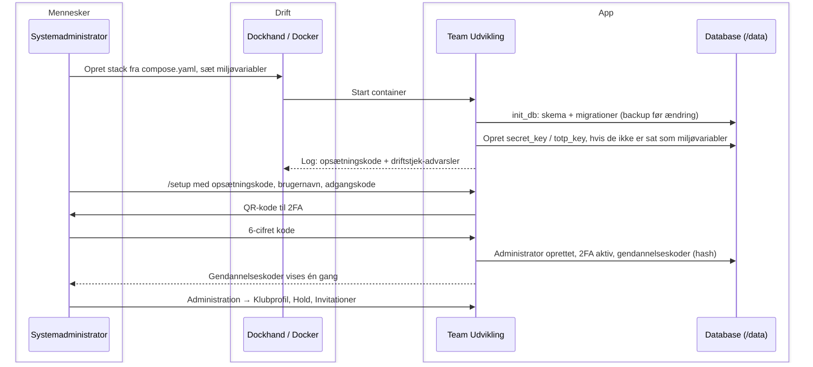
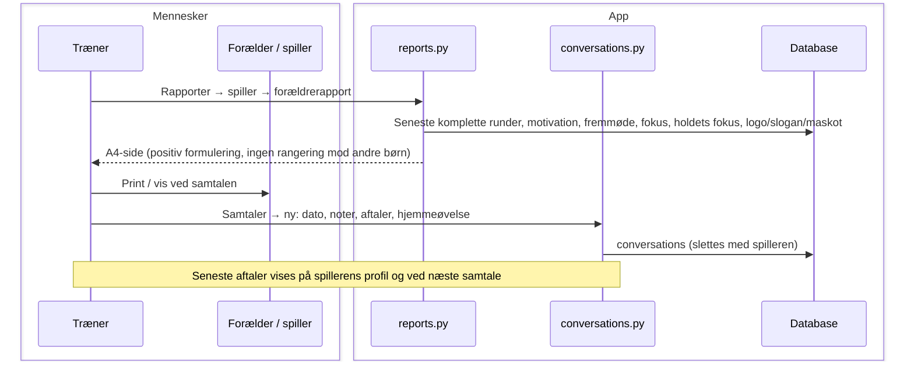
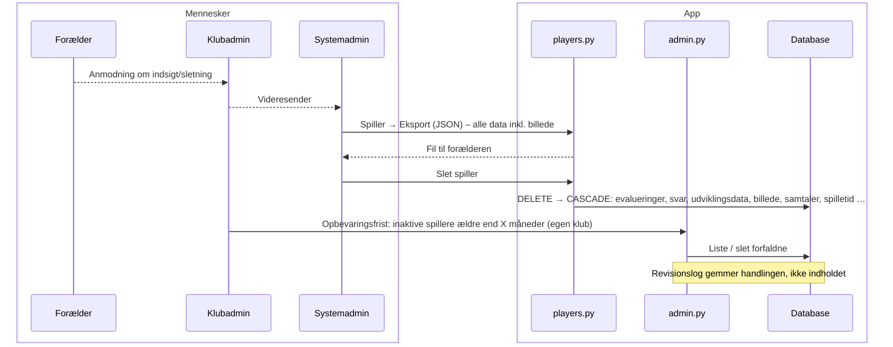
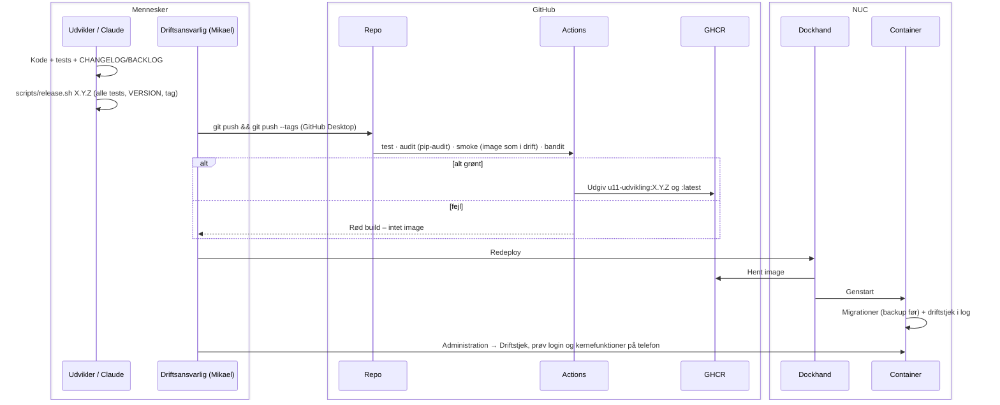

# Swim lanes – processer på tværs af roller og systemdele

Hver proces er tegnet som et sekvensdiagram: én lodret bane pr. aktør (rolle eller systemdel), læst oppefra og ned.
Kasserne (`box`) samler banerne i **mennesker**, **app** og **eksterne systemer**. Diagrammerne er Mermaid og vises på GitHub.

Oversigt:
1. [Første opsætning](#1-første-opsætning)
2. [Invitation og oprettelse af bruger](#2-invitation-og-oprettelse-af-bruger)
3. [Login med 2FA og «husk enhed»](#3-login-med-2fa-og-husk-enhed)
4. [Evalueringsrunde](#4-evalueringsrunde)
5. [Kamp: kalender → kampforslag → opstilling → spilletid](#5-kamp-kalender--kampforslag--opstilling--spilletid)
6. [Motivationsskema via spillerlink](#6-motivationsskema-via-spillerlink)
7. [Spillerrapport og forældresamtale](#7-spillerrapport-og-forældresamtale)
8. [Besked med e-mail](#8-besked-med-e-mail)
9. [Nulstilling af adgangskode eller 2FA](#9-nulstilling-af-adgangskode-eller-2fa)
10. [Sæsonskifte og holdskifte](#10-sæsonskifte-og-holdskifte)
11. [GDPR: indsigt, opbevaringsfrist og sletning](#11-gdpr-indsigt-opbevaringsfrist-og-sletning)
12. [Udgivelse og drift](#12-udgivelse-og-drift)

---

## 1. Første opsætning



## 2. Invitation og oprettelse af bruger

```mermaid
sequenceDiagram
  box Mennesker
    participant AD as Chef-træner / klubadmin
    participant NY as Ny træner
  end
  box App
    participant APP as Team Udvikling
    participant MQ as E-mail-kø (baggrundstråd)
  end
  box Eksternt
    participant SMTP as SMTP-udbyder
  end
  AD->>APP: Invitationer: e-mail, rolle (træner/assistent/chef), hold + egen 2FA-kode
  APP->>APP: Rettighedstjek (kun egne hold/klub), maks. ventende pr. klub
  APP->>APP: Token (256 bit) → kun hash gemmes, udløber om 7 dage
  APP->>MQ: Læg mail i kø
  APP-->>AD: «Invitation sendt»
  MQ->>SMTP: Send (op til 6 forsøg)
  SMTP-->>NY: Mail med /invitation/<token>
  NY->>APP: Åbn link (token fjernes fra adgangsloggen)
  NY->>APP: Vælg brugernavn (ledigt-tjek) + adgangskode
  APP->>NY: QR-kode til 2FA
  NY->>APP: 6-cifret kode
  APP->>APP: Bruger oprettet i klub og hold; invitation brugt (engangs)
  APP-->>NY: Logget ind, gendannelseskoder vises én gang
```

## 3. Login med 2FA og «husk enhed»

```mermaid
sequenceDiagram
  box Mennesker
    participant U as Bruger
  end
  box App
    participant AUTH as auth.py
    participant LK as lockout / throttle
    participant DB as Database
  end
  U->>AUTH: /login: brugernavn + adgangskode
  AUTH->>LK: IP spærret? bruger+IP spærret? konto låst?
  alt for mange forsøg
    LK-->>U: 429 / «prøv igen senere» + sikkerhedslog
  else ok
    AUTH->>DB: Tjek scrypt-hash
    alt forkert
      AUTH->>LK: Registrér fejl (IP, bruger+IP)
      AUTH-->>U: Generisk fejl
    else korrekt
      opt gyldig «husk enhed»-cookie
        AUTH->>DB: Roter token
        AUTH-->>U: Logget ind (ingen 2FA)
      end
      AUTH-->>U: /login/2fa
      U->>AUTH: TOTP-kode eller gendannelseskode
      AUTH->>DB: Kode gyldig og trin ikke brugt før
      AUTH->>DB: Ny session-id, last_login, oprydning, daglig backup hvis forfalden
      AUTH-->>U: Forside (mobil: /m); valgfrit «husk enhed» i 30 dage
    end
  end
```

## 4. Evalueringsrunde

```mermaid
sequenceDiagram
  box Mennesker
    participant CT as Chef-træner
    participant TR as Træner(e)
    participant AS as Assistent
  end
  box App
    participant EV as evaluation.py
    participant MO as model.py / levels.py
    participant DB as Database
  end
  CT->>EV: Evalueringsrunder: navngiv runde og dato
  TR->>EV: /eval/<runde>/<spiller>: 24 kriterier 1–5, DBU-niveauudsagn, samlet niveau
  EV->>DB: Første indtastning → runde åbnet (lukker efter 30 dage)
  EV->>DB: Gem scores pr. træner (revisionslog uden scores)
  AS->>EV: Evaluerer på samme måde
  EV->>DB: Gemmes, men markeres som assistent
  CT->>EV: Vælg om assistentens evaluering tæller med i runden
  EV->>DB: assist_ok_<runde>
  Note over EV,DB: Runden vises først i oversigter/profiler, når alle aktive spillere er evalueret
  TR->>EV: Teamoversigt, udvikling, områder, spillerprofil
  EV->>MO: load_rounds (uden fravalgte assistenter) → rolle-gennemsnit, samlet, enighed, niveau
  MO-->>TR: Tabeller, varmekort (1 rød … 3 grøn … 5 lyseblå), radar
  Note over CT,EV: Efter 30 dage er runden lukket for rettelser; chef-træner/admin kan genåbne
```

## 5. Kamp: kalender → kampforslag → opstilling → spilletid

```mermaid
sequenceDiagram
  box Mennesker
    participant CT as Chef-træner
    participant TR as Træner
  end
  box App
    participant MA as matches.py
    participant IC as ical.py
    participant SG as suggest.py
    participant DB as Database
  end
  box Eksternt
    participant CAL as Kalenderfeed (KampKlar m.fl.)
  end
  CT->>DB: Holdindstillinger: kalenderlink (https, offentlig IP)
  TR->>MA: Kampe → Hent kampforslag
  alt hentet inden for 1 minut
    MA->>DB: Brug sidst hentede
  else
    MA->>IC: fetch(url)
    IC->>CAL: HTTPS til kontrolleret IP (maks. 1 MB, 8 s, 3 omdirigeringer)
    CAL-->>IC: .ics
    IC-->>MA: Aftaler (UID, dato, tid, sted, titel)
  end
  MA-->>TR: Kommende aftaler, ikke oprettet; modstander gættet; kampe forvalgt
  TR->>MA: Ret modstander, vælg, «Opret valgte kampe»
  MA->>DB: matches (+ ical_uid mod dubletter)
  TR->>MA: Åbn kamp → «Foreslå opstilling» (fravær, målmand til/fra)
  MA->>DB: Tidligere spilletid pr. spiller og positionsgruppe
  MA->>SG: Fordel pr. periode: mindst spilletid først, hvide pletter billigst
  SG-->>TR: Forslag + «nye positioner: …» (ikke gemt endnu)
  TR->>MA: Ret frit → Gem kamp
  MA->>DB: match_slots (periode × plads → spiller)
  TR->>MA: Spilletid og hvide pletter (seneste 3/5/10 kampe eller alle)
  MA-->>TR: Minutter pr. spiller og gruppe, hvide pletter, lav spilletid
```

## 6. Motivationsskema via spillerlink

```mermaid
sequenceDiagram
  box Mennesker
    participant TR as Træner
    participant SP as Spiller / forælder
  end
  box App
    participant MOT as motivation.py
    participant DB as Database
  end
  TR->>MOT: Motivation → Spillerlinks → Opret link til spiller
  MOT->>DB: Tidligere ubrugte links tilbagekaldes; nyt token (kun HMAC-hash), 7 dage
  MOT-->>TR: Link vises én gang (kopiér / del)
  TR-->>SP: Sender linket (sms, besked)
  SP->>MOT: GET /svar/<token> (forbruger ikke linket)
  MOT-->>SP: Kun fornavn + skemaet
  SP->>MOT: POST svar
  MOT->>DB: Atomisk: link brugt; svar gemt; motivation_log (trigger) gemmer historik
  MOT-->>SP: Tak
  alt ugyldigt/udløbet/brugt token
    MOT->>DB: Tæller mod IP-spærre
    MOT-->>SP: Generisk fejlside
  end
  TR->>MOT: Matrix / spillerrapport viser svar og udvikling over tid
  Note over TR,MOT: Alternativ: tablet-visning (/motivation/tablet) under træning med træneren logget ind
```

## 7. Spillerrapport og forældresamtale



## 8. Besked med e-mail

```mermaid
sequenceDiagram
  box Mennesker
    participant AF as Afsender (chef-træner / klubadmin / sysadmin)
    participant MO as Modtagere
  end
  box App
    participant IN as messages.py
    participant MQ as mail_queue (tråd pr. worker)
    participant DB as Database
  end
  box Eksternt
    participant SMTP as SMTP
  end
  AF->>IN: Ny besked: til hold / klub / alle, ✓ send også som e-mail
  IN->>IN: Rettighed til målgruppen
  IN->>DB: messages
  IN->>DB: mail_queue: én række pr. modtager med e-mail (ikke afsender)
  IN-->>AF: «Sendt – e-mail lagt i kø» (venter ikke på SMTP)
  MQ->>DB: Lås forfaldne rækker (locked_until)
  MQ->>SMTP: Send
  alt OK
    MQ->>DB: sendt; brødtekst slettes
  else fejl
    MQ->>DB: forsøg+1, næste forsøg om 1 min … 3 t; efter 6: opgivet (brødtekst slettes)
  end
  MO->>IN: Næste login: «Nye beskeder» på forsiden + ✉-tæller i topbjælken
  MO->>IN: Læst / svar til afsender (privat svar)
  Note over AF,DB: Sysadmin kan se status under Administration → E-mail-kø (uden indhold)
```

## 9. Nulstilling af adgangskode eller 2FA

```mermaid
sequenceDiagram
  box Mennesker
    participant U as Bruger
    participant AD as Administrator
  end
  box App
    participant RS as reset.py
    participant DB as Database
  end
  box Eksternt
    participant SMTP as SMTP
  end
  U-->>AD: «Jeg kan ikke logge ind» (uden for appen)
  AD->>RS: Brugere → bruger → send nulstillingslink + egen 2FA-kode
  RS->>DB: Token (kun hash), 1 time, engangs; maks. pr. bruger
  RS->>SMTP: Send straks (fejl vises med det samme; token fjernes ved fejl)
  SMTP-->>U: Mail med /nulstil/<token>
  U->>RS: Åbn link
  alt adgangskode
    U->>RS: Ny adgangskode → derefter normal 2FA
  else 2FA
    U->>RS: Nuværende adgangskode + ny QR/kode
  end
  RS->>DB: Opdatér; alle sessioner og «husk enhed» tilbagekaldes; token brugt
  Note over U,RS: En kompromitteret postkasse kan ikke alene omgå 2FA
```

## 10. Sæsonskifte og holdskifte

```mermaid
sequenceDiagram
  box Mennesker
    participant CT as Chef-træner / klubadmin
  end
  box App
    participant TM as team.py
    participant TF as transfer.py
    participant DB as Database
  end
  CT->>TM: Sæsonskifte: navn på nyt hold
  TM->>DB: Nyt hold med aktive spillere (uden scores, noter, billeder), trænere og indstillinger
  TM-->>CT: Gammelt hold bevaret (kan arkiveres → skrivebeskyttet)
  CT->>TF: Spiller → Flyt til andet hold
  TF->>DB: Evalueringer kopieres til eval_history (kun medtagne assistenter)
  TF->>DB: Spilletid, opstillinger, links på gammelt hold slettes; spiller.team_id ændres
  Note over TF,DB: Profilen på det nye hold viser historikken som «fra tidligere hold»
```

## 11. GDPR: indsigt, opbevaringsfrist og sletning



## 12. Udgivelse og drift


